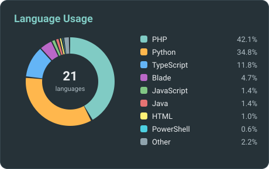
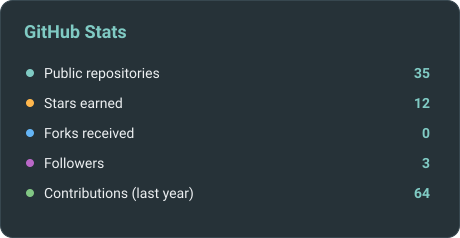

<!-- ===================== HEADER ===================== -->

  

  

  
  
  

<!-- ===================== STATS (borderless, fluid) ===================== -->

  
  

<!-- ===================== TECH STACK (borderless, fluid) ===================== -->
## Tech Stack

<h3 align="center">Languages</h3>

  
  
  
  
  
  
  

<h3 align="center">Backend</h3>

  
  
  
  
  
  
  
  
  

<h3 align="center">Frontend</h3>

  
  
  
  
  
  

<h3 align="center">Databases</h3>

  
  
  
  

<h3 align="center">Cloud &amp; DevOps</h3>

  
  
  
  
  

<h3 align="center">Data Visualisation &amp; Messaging</h3>

  
  
  
  

<!-- ===================== ACTIVITY ===================== -->
## Activity

  

  

<!-- ===================== CONTACT ===================== -->
## Let's Connect

I'm open to **consulting engagements** through Zuqongtech, **open-source collaboration**, and conversations with the PNG tech community.

  
  
  
  

  

